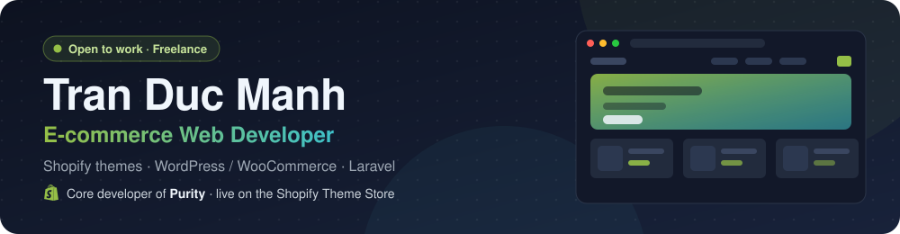

I build online stores and the systems behind them, from requirements to handover. Since 08/2024 I have been a Shopify Theme Developer at **NextSky**, where I am a core developer of **Purity**, a paid theme on the Shopify Theme Store, and developed **Laurel**, a new theme now getting its second preset. Outside work I take freelance projects: two WooCommerce stores delivered to clients, two Laravel business systems in development, and an open-source WooCommerce store kit.

English · [Tiếng Việt](README.vi.md)

## Tech stack

**Strong**

        

**Working**

         

**AI tools**

 

Also: QA, Theme Check, Shopify Theme Store review, Online Store 2.0, theme blocks, Shopify CLI.

---

## Featured work

### Purity · Shopify Theme Store · NextSky · 2025 – present

  

A beauty theme sold on the Shopify Theme Store ($300), rated 100% positive across 137 merchant reviews (October 2026).
[Theme Store](https://themes.shopify.com/themes/purity/presets/purity) · [Live demo](https://purity.nextsky.co/)

- **Core developer:** I build most of the theme's sections and core features in Liquid, JavaScript and Web Components.
- **Roadmap from real merchants:** I audit stores that bought the theme (personas, bugs, features they struggle with) and write the specs for the next updates.
- **Release quality:** I test and accept tasks from teammates and other teams, then QA each release against Shopify Theme Store requirements before submission.
- **Team and merchants:** I train new developers, write documentation, answer support tickets and build custom requests for merchants.
- **Version 1.6.0 (October – November 2026):** I built the styling, layouts and demo setup for the new Pet preset (Yum), and video slides for the image-with-text carousel. I turned the merchant research into 25 update tasks, checked each one on the 1.6.0 release with Theme Editor screenshots, and filed the first 15 in the team's task tool.

Also contributed to: Novy, Woomen, Glozin.

### Laurel · Shopify theme · NextSky · 2026

  

I developed Laurel, a new NextSky theme (not yet released), and I am finishing its second preset, Victoria. 126 merged pull requests so far.

- **Theme developer:** I built Laurel's sections, blocks and theme settings in Liquid and JavaScript.
- **Victoria preset, almost done:** built from Figma: product page, homepage, mega menu, product cards, blog, footer and Judge.me reviews, matched to the design on desktop and mobile.
- **Settings instead of hardcoded CSS:** I turned design differences into theme settings that every preset can use: rating block style, vendor and price position on product cards, mobile heading sizes, progress-line pagination for featured collections, and the footer country picker.
- **Clean preset CSS:** I removed rules that did nothing and moved sizes to type tokens.
- **Release flow:** each change lands on the development branch first, then syncs to the live demo branch.

### Client stores · WordPress / WooCommerce · freelance, delivered

  

Both projects were done solo, end to end: requirements, design, build, product and content entry, hosting and domain, handover.

| [Veterinary supplies store](https://thuytruongle.online/) | [Car accessories store](https://naducar.online/) |
| :--- | :--- |
| Child theme plus a custom site plugin in PHP. | Customized Flatsome child theme. |
| Customers shop by symptom ("piglets with diarrhea") instead of by product name. | Promo popup that copies the voucher code and sends the visitor to the shop. |
| The vet's TikTok videos are linked to the exact products used in them; product cards show the label dosage. | Category landing sections and calls to action. |
| Ordering by cart, Zalo or phone, with call-back confirmation and cash on delivery. | SEO and page speed setup. |
| Knowledge blog, on-page SEO, structured data, WebP images. | |
| Eight policy pages and the e-commerce notification filed with the Ministry of Industry and Trade; prescription products stay non-purchasable until approval. | |
| Orders synced to Google Sheets; shop filters by category, audience and price. | |
| Owner admin guide and a handover record. | |

### WooCommerce Store Kit · open source · 2026

   

[Repository](https://github.com/DucManh-DEV-NEXTSKY/woocommerce-store-kit) · release 1.0.0

A reusable starter kit I extracted from the veterinary store, so the next WooCommerce store starts from a tested base.

- A management plugin, a Blocksy child theme, design tokens with presets, and an optional veterinary module.
- A setup script creates each new store with its own database, passwords and salts, keeps it out of search and in coming-soon mode until the owner opens it, and refuses to overwrite data it did not create.
- Release packages ship with a manifest of versions and SHA-256 checksums.

### In development · Laravel · freelance (client names withheld)

   

- **Agency CRM:** Laravel 13, Filament 5, Livewire 4, PostgreSQL. Covers leads and sales pipeline, versioned quotes, contracts, projects, handover and warranty, receivables and payables, and renewal reminders for client domains and hosting. Adds an audit history and encrypted backups. Also a public landing page that takes its pricing from the CRM's service packages, with a lead form, and role-based user guides for sales and technical staff. Built solo.
- **Multi-tier distributor platform:** Laravel. Storefront, agent portal and admin, with 3-tier commissions, a daily bonus pool, ranks, VietQR payments and an immutable wallet ledger. I also did the business analysis and design: 14 modules, 607 business rules, 143 use cases and 540 acceptance test cases. Built so far: agent tree, wallet and commissions, bonus pool, ranks, withdrawals, product combos, refunds, security hardening, and a versioned CMS with SEO, with CI set up.

## Working with AI

- I use Claude Code, Cursor and Codex every day on Shopify themes: building sections from Figma, reviewing code, and QA.
- I write project rules (`AGENTS.md`) and workflows so agents follow each theme's existing patterns.
- I use AI for business analysis: drafting specs and system design, as in the distributor platform above.
- I keep a personal library of agent skills, for example one that reviews Shopify theme pull requests.
- I automate team admin work with agents: turning research into tracked tasks, capturing screenshots as evidence, and filing the tasks in the internal task tool.
- This workflow is how I deliver WordPress and Laravel projects solo.

## Education

Posts and Telecommunications Institute of Technology (PTIT), Information Security, graduated 2025.
