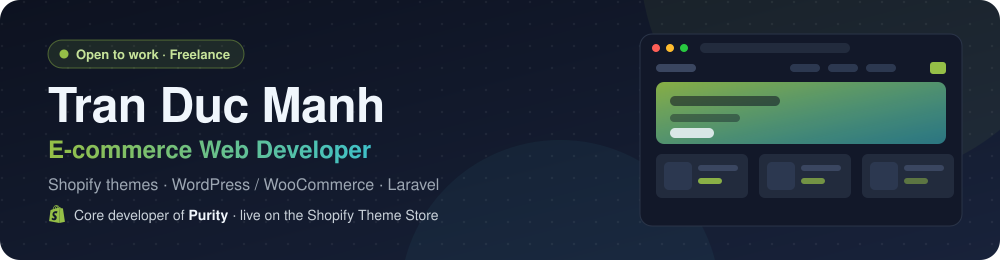

I build online stores and the systems behind them, from requirements to handover. Since 08/2024 I have been a Shopify Theme Developer at **NextSky**, where I am a core developer of **Purity**, a paid theme on the Shopify Theme Store. Outside work I take freelance projects: two WooCommerce stores delivered to clients and two Laravel business systems in development.

English · [Tiếng Việt](README.vi.md)

## Tech stack

**Strong**

        

**Working**

         

**AI tools**

 

Also: QA, Theme Check, Shopify Theme Store review, Online Store 2.0, theme blocks, Shopify CLI.

---

## Featured work

### Purity · Shopify Theme Store · NextSky · 2025 – present

  

A beauty theme sold on the Shopify Theme Store ($300), rated 100% positive across 137 merchant reviews (October 2026).
[Theme Store](https://themes.shopify.com/themes/purity/presets/purity) · [Live demo](https://purity.nextsky.co/)

- **Core developer:** I build most of the theme's sections and core features in Liquid, JavaScript and Web Components.
- **Roadmap from real merchants:** I audit stores that bought the theme (personas, bugs, features they struggle with) and write the specs for the next updates.
- **Release quality:** I test and accept tasks from teammates and other teams, then QA each release against Shopify Theme Store requirements before submission.
- **Team and merchants:** I train new developers, write documentation, answer support tickets and build custom requests for merchants.

Also contributed to: Laurel, Novy, Woomen, Glozin.

### Client stores · WordPress / WooCommerce · freelance, delivered

  

Both projects were done solo, end to end: requirements, design, build, product and content entry, hosting and domain, handover.

| [Veterinary supplies store](https://thuytruongle.online/) | [Car accessories store](https://naducar.online/) |
| :--- | :--- |
| Child theme plus a custom site plugin in PHP. | Customized Flatsome child theme. |
| Customers shop by symptom ("piglets with diarrhea") instead of by product name. | Promo popup that copies the voucher code and sends the visitor to the shop. |
| The vet's TikTok videos are linked to the exact products used in them; product cards show the label dosage. | Category landing sections and calls to action. |
| Ordering by cart, Zalo or phone, with call-back confirmation and cash on delivery. | SEO and page speed setup. |
| Knowledge blog, on-page SEO, structured data, WebP images. | |

### In development · Laravel · freelance (client names withheld)

   

- **Agency CRM:** Laravel 13, Filament 5, Livewire 4, PostgreSQL. Covers leads and sales pipeline, versioned quotes, contracts, projects, handover and warranty, receivables and payables, and renewal reminders for client domains and hosting. Adds an audit history and encrypted backups. Built solo.
- **Multi-tier distributor platform:** Laravel. Storefront, agent portal and admin, with 3-tier commissions, a daily bonus pool, ranks, VietQR payments and an immutable wallet ledger. I also did the business analysis and design: 14 modules, 607 business rules, 143 use cases and 540 acceptance test cases. Core modules are built.

## Working with AI

- I use Claude Code, Cursor and Codex every day on Shopify themes: building sections from Figma, reviewing code, and QA.
- I write project rules (`AGENTS.md`) and workflows so agents follow each theme's existing patterns.
- I use AI for business analysis: drafting specs and system design, as in the distributor platform above.
- This workflow is how I deliver WordPress and Laravel projects solo.

## Education

Posts and Telecommunications Institute of Technology (PTIT), Information Security, graduated 2025.
