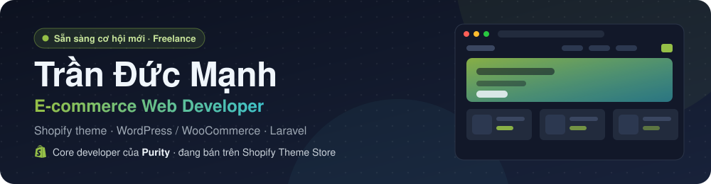

Tôi xây dựng website bán hàng và các hệ thống phía sau, từ lúc nhận yêu cầu đến khi bàn giao. Từ 08/2024 tôi là Shopify Theme Developer tại **NextSky**, core developer của **Purity**, một theme trả phí trên Shopify Theme Store. Ngoài giờ tôi nhận dự án freelance: đã bàn giao hai cửa hàng WooCommerce và đang phát triển hai hệ thống nghiệp vụ bằng Laravel.

[English](README.md) · Tiếng Việt

## Công nghệ

**Thành thạo**

        

**Đã dùng trong dự án**

         

**Công cụ AI**

 

Ngoài ra: QA, Theme Check, Shopify Theme Store review, Online Store 2.0, theme blocks, Shopify CLI.

---

## Dự án nổi bật

### Purity · Shopify Theme Store · NextSky · 2025 – nay

  

Theme ngành làm đẹp bán trên Shopify Theme Store (300 USD), 100% đánh giá tích cực trên 137 đánh giá của merchant (tháng 10/2026).
[Theme Store](https://themes.shopify.com/themes/purity/presets/purity) · [Demo](https://purity.nextsky.co/)

- **Core developer:** phát triển phần lớn section và tính năng lõi của theme bằng Liquid, JavaScript và Web Components.
- **Lộ trình từ merchant thật:** audit các store đã mua theme (persona, lỗi, tính năng họ dùng chưa được) và viết đặc tả cho các bản cập nhật.
- **Chất lượng phát hành:** test và nghiệm thu task của thành viên và các team khác, QA từng bản phát hành theo yêu cầu của Shopify Theme Store trước khi submit.
- **Đội ngũ và merchant:** đào tạo nhân sự mới, viết tài liệu, trực support và làm các yêu cầu custom cho merchant.

Có tham gia thêm: Laurel, Novy, Woomen, Glozin.

### Cửa hàng cho khách · WordPress / WooCommerce · freelance, đã bàn giao

  

Cả hai dự án do tôi làm một mình từ đầu đến cuối: lấy yêu cầu, thiết kế, lập trình, nhập sản phẩm và nội dung, hosting và tên miền, bàn giao.

| [Cửa hàng thuốc thú y](https://thuytruongle.online/) | [Cửa hàng phụ kiện ô tô](https://naducar.online/) |
| :--- | :--- |
| Child theme và plugin riêng viết bằng PHP. | Tuỳ biến child theme Flatsome. |
| Khách tìm sản phẩm theo triệu chứng ("heo con tiêu chảy") thay vì theo tên thuốc. | Popup khuyến mãi tự copy mã voucher và chuyển khách sang cửa hàng. |
| Video TikTok của bác sĩ gắn với đúng sản phẩm trong video, thẻ sản phẩm hiện liều theo nhãn. | Các khối landing theo danh mục và nút kêu gọi hành động. |
| Đặt hàng qua giỏ hàng, Zalo hoặc điện thoại, cửa hàng gọi lại xác nhận, trả tiền khi nhận. | Thiết lập SEO và tối ưu tốc độ. |
| Blog kiến thức, SEO on-page, dữ liệu có cấu trúc, ảnh WebP. | |

### Đang phát triển · Laravel · freelance (ẩn tên khách hàng)

   

- **CRM cho agency:** Laravel 13, Filament 5, Livewire 4, PostgreSQL. Gồm khách hàng và pipeline bán hàng, báo giá theo phiên bản, hợp đồng, dự án, bàn giao và bảo hành, công nợ phải thu và phải trả, nhắc gia hạn tên miền và hosting của khách. Có lịch sử thay đổi và backup mã hoá. Tự làm một mình.
- **Hệ thống phân phối đại lý nhiều cấp:** Laravel. Website bán hàng, cổng đại lý và trang quản trị, với hoa hồng 3 tầng, quỹ thưởng ngày, xếp hạng, thanh toán VietQR và sổ ví không sửa được. Tôi làm cả phân tích nghiệp vụ và thiết kế: 14 phân hệ, 607 quy tắc nghiệp vụ, 143 ca sử dụng và 540 ca kiểm thử nghiệm thu. Đã code xong các phân hệ lõi.

## Làm việc cùng AI

- Dùng Claude Code, Cursor và Codex hằng ngày cho theme Shopify: dựng section từ Figma, review code và QA.
- Viết rules cho dự án (`AGENTS.md`) và quy trình để agent làm theo đúng pattern có sẵn của theme.
- Dùng AI cho phân tích nghiệp vụ: soạn đặc tả và thiết kế hệ thống, như hệ thống đại lý ở trên.
- Nhờ quy trình này tôi làm một mình được các dự án WordPress và Laravel.

## Học vấn

Học viện Công nghệ Bưu chính Viễn thông (PTIT), ngành An toàn thông tin, tốt nghiệp 2025.
